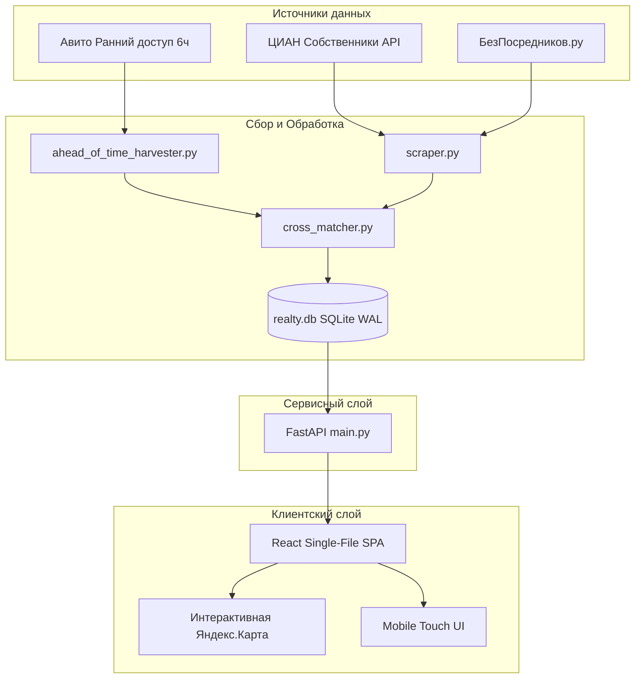

# Архитектура сервиса SofDom

## 1. Общий обзор системы

SofDom спроектирован как высокопроизводительный сервис перехвата и агрегации объявлений аренды недвижимости для Томска.

## 2. Слой базы данных (`backend/realty.db`)
- Используется SQLite с включенным журналом **WAL (Write-Ahead Logging)** для параллельного чтения без блокировок.
- Основная таблица `apartments`:
  - `id`: уникальный идентификатор лота с префиксом источника (`avito_...`, `cian_...`, `bezposr_...`).
  - `source`: источник лота (`avito`, `cian`, `bezposrednikov`).
  - `is_secret_early_access`: флаг 6-часового эксклюзива Авито.
  - `title`, `price`, `deposit`, `commission`: финансовые условия аренды.
  - `district`: нормализованный административный район Томска.
  - `address`, `city`, `lat`, `lng`: точные гео-координаты.
  - `phone`: прямой телефон собственника без маскировки.
  - `photos_json`: массив ссылок на полноразмерные фотографии.
  - `description`: подробный текст собственника.
  - `created_at`, `updated_at`: временные метки свежести.

## 3. Слой API (`backend/main.py`)
- Построен на базе **FastAPI + Uvicorn**.
- Отдает данные в форматах JSON для каталога, детального просмотра и гео-точек карты.
- Поддерживает фильтрацию по количеству комнат, ценовому диапазону, районам Томска и радиусу от точки.

## 4. Клиентский слой (`frontend/`)
- **React 18 + TypeScript + Vite**.
- Собирается через `vite-plugin-singlefile` в монолитный оптимизированный HTML-файл для хостинга без сложной серверной инфраструктуры.
- Адаптивный мобильный интерфейс с поддержкой тач-свайпов, защитой от случайного возврата жестом при зуме карты и полноэкранным Lightbox-просмотром галереи.
