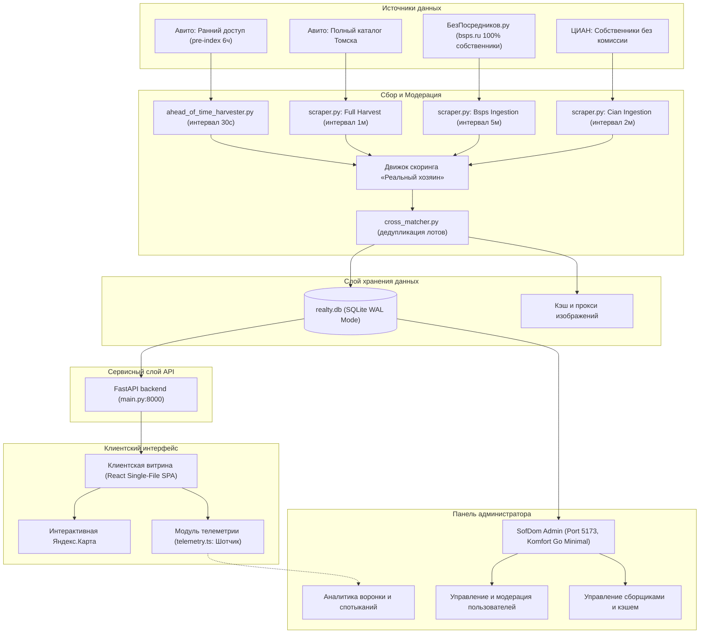

# Архитектура сервиса SofDom (Томск)

## 1. Общий обзор системы

**SofDom** спроектирован как модульный распределенный комплекс мониторинга, нормализации и предоставления предложений долгосрочной аренды квартир в городе Томске.



---

## 2. Контуры сбора данных (Data Ingestion)

Система осуществляет непрерывный мониторинг 4 независимых каналов:

1. **Авито (Ранний доступ 6 часов):**
   - Перехват свежих объявлений физических лиц через WebSocket/API поток до индексации в общем каталоге.
   - Позволяет получить лот на 2–6 часов раньше любых публичных сервисов.
2. **Авито (Полный каталог Томска):**
   - Непрерывный мониторинг общего каталога города с частотой опроса 60 секунд.
   - Забирает все новые объявления и направляет их в строгий фильтр модерации.
3. **БезПосредников.ру (`bsps.ru`):**
   - 100% подтверждённые собственники.
   - Сборщик опрашивает базу каждые 5 минут, сохраняя оригинальные галереи и прямые контакты.
4. **ЦИАН (Собственники):**
   - Запросы с заголовком `is_by_homeowner=1` и `deal_type=rent`.
   - Исключает объявления риелторов и предложения с комиссией.

---

## 3. Движок модерации «Реальный хозяин» (Anti-Realtor Scoring)

Любое входящее объявление проходит через 4-уровневую систему верификации:

1. **Частотный анализ номера телефона:**
   - Если номер телефона в течение 90 дней появлялся более чем в 1 уникальном объявлении аренды — лот блокируется с пометкой `REALTOR_MULTI_LISTING`.
2. **Словарь стоп-слов комиссий:**
   - Поиск по тексту описания: *«комиссия»*, *«агентство»*, *«риелтор»*, *«оплата по факту заселения»*, *«АН»*, *«договор агентства»*. При обнаружении — автоматический отсев.
3. **Маркеры прямого собственника:**
   - Анализ ключевых фраз: *«сдам лично»*, *«я собственник»*, *«без комиссии»*, *«хозяин»*. Начисление положительного коэффициента доверия.
4. **Дедупликация (`cross_matcher.py`):**
   - Сравнение по нормализованному адресу (улица, номер дома), этажности, площади (±1.5 м²) и хэшам фотографий. Исключение повторов одних и тех же квартир из разных источников.

---

## 4. Слой хранения (Storage Layer)

- **СУБД:** `backend/realty.db` на SQLite 3 с журналом **WAL (Write-Ahead Logging)**.
- Режим WAL обеспечивает конкурентный доступ: сборщики могут непрерывно записывать данные, не блокируя быстрые выборки для клиентского API.
- Основные таблицы:
  - `apartments`: 162 проверенных объекта с нормализованными районами, ценами, депозитами, описанием и контактами.
  - `sources_meta`: состояние и таймстемпы последних проходов харвестеров.
  - `realtor_blacklist`: реестр заблокированных телефонов и агентств.

---

## 5. Сервисный слой API (`backend/main.py`)

- Построен на базе **FastAPI** с асинхронными обработчиками на **Uvicorn**.
- Поддерживает:
  - Пагинацию и гибкую фильтрацию по ценам, комнатности и районам (`/api/apartments`).
  - Облегченную выдачу гео-точек для мгновенного рендеринга на карте (`/api/geo/map`).
  - Профиль объекта со всеми характеристиками и полноразмерными фото (`/api/apartment/{id}`).
  - Агрегированную статистику по районам и сборщикам (`/api/stats`).

---

## 6. Клиентский интерфейс (`frontend/`)

- Стек: **React 18 + Vite + TypeScript**.
- Архитектура сборки: `vite-plugin-singlefile` компилирует всю разметку, стили и скрипты в один монолитный файл `index.html` (672 kB). Это позволяет размещать витрину на любом статическом хостинге (GitHub Pages, S3, Cloudflare Pages) без серверных зависимостей.
- **Мобильный стандарт Авито (Mobile Avito UX):**
  - **Квадратная плитка 1:1 (`aspect-ratio: 1 / 1`):** фотографии комнат в 2-колоночной мобильной выдаче отображаются высокими, просторными и без сжатия пропорций.
  - **Геометрия и стиль:** скругление верхних углов 11–12px, чисто белый фон карточки `#ffffff` с микробордером `#e8eaed` на нейтральном тёплом фоне ленты `#f7f8f9`.
  - **Иерархия информации:** крупная цена 16.5px bold + `/мес.`, заголовок лота, район («Томск, Советский р-н»), время публикации («Сегодня»).
  - **Sticky Action Dock:** на детальной странице внизу закреплена 48px фиксированная панель с крупной зеленой кнопкой связи («Позвонить» `#04e061`) и кнопкой сообщения («Написать» `#ffffff`), при этом стандартная нижняя навигация автоматически скрывается.
  - **Полноэкранный Lightbox:** просмотр фото с 2x аппаратным зумом, свайпами закрытия и листания, экранированием сторонних водяных знаков и отсутствием пустых полей.
- **Жизненный цикл объявления (Сдано / Снято с публикации):**
  - Тип `Offer` содержит атрибут `status?: 'active' | 'rented' | 'archived'`.
  - Квартиры со статусом `rented` (или находящиеся в локальном хранилище `sofdom_rented_offers_v1`) моментально исключаются из каталога и поисковой выдачи.
  - При открытии по прямой ссылке выводится контрастный информационный баннер: `✓ СДАНО • Квартира уже сдана и снята с публикации. Контакты собственника скрыты`.
  - Владелец квартиры или администратор может в 1 клик переключить статус («Снять с публикации (сдано)» / «↩ Вернуть в активный поиск»).
- **Собственные фирменные идентификаторы:**
  - Все объекты переведены на единый реестр `SD-1001` .. `SD-1170`. Никаких сторонних номеров и названий сервисов в интерфейсе не отображается.

---

## 7. Модуль телеметрии («Шотчик») и Детектор сбоев

- Расположение: `frontend/src/lib/telemetry.ts`.
- Архитектура: **Fire-and-forget** (по протоколу аналитики Komfort Go). Все события записываются в неблокирующий кольцевой буфер `localStorage` (`sofdom_telemetry_events_v1`).
- Отслеживаемые события:
  - `session_start`, `session_heartbeat`, `session_end` — активное время пользователя на сайте.
  - `scroll_depth` — пороги глубины изучения ленты: 25%, 50%, 75%, 100%.
  - `listing_view` — открытие детальной карточки.
  - `phone_reveal_click` — ключевая конверсия (раскрытие контакта собственника).
  - `favorite_toggle` — добавление/удаление из избранного.
  - `unpublish_toggle` — снятие или возврат квартиры в поиск собственником.
  - `filter_change` — изменение параметров фильтрации.
- **Friction Log (Детектор спотыканий):**
  - `broken_photo_cdn`: автоматический перехват 404/ошибок загрузки фото на CDN с авто-подстановкой резервного кэша.
  - `zero_search_results`: отслеживание поисковых запросов и фильтров, при которых выдача оказалась пустой.
  - `map_tile_latency`: контроль задержки рендеринга карт с быстрым fallback-режимом.
  - `geolocation_denied`: отслеживание отказов в геолокации и мгновенный перевод на ручной выбор района.

---

## 8. Автономная панель администратора (`admin/`)

- Стек: **React + Vite + TypeScript + Tailwind CSS** на порту `5173`.
- **Дизайн-система:** Полная адаптация строгой монохромной стилистики **Komfort Go**:
  - Графитовый `#111418` и темный `#1F2937` для активных элементов и кнопок.
  - Оттенки серого `#5B6B7A` и `#8A94A0` для подписей и вторичных данных.
  - Фон `#F7F8F9`, белые карточки `#FFFFFF` и контуры `#ECECEC`.
  - Линейные иконки Lucide без использования эмодзи и кричащих градиентов.
- **Разделы панели:**
  1. `/overview` — Пульс базы: средняя цена, распределение по районам, свежие лоты.
  2. `/listings` — Управление 162 объявлениями с фильтрацией по источникам, районам, а также **жизненному циклу (Все / Активные в поиске / Снято со статусом Сдано)** с кнопкой переключения статуса в 1 клик и прямой ссылкой-предпросмотром на сайте.
  3. `/analytics` — Аналитика воронки («Шотчик»), реальные сессии и Friction Log.
  4. `/users` — Управление пользователями: временная блокировка на 24 часа, вечный бан, удаление, регулировка суточных лимитов раскрытия номеров (5, 15, 30, безлимит).
  5. `/scrapers` — Статус 4 каналов сбора данных, прозрачный мониторинг алгоритма «Реальный хозяин» и сброс кэша.

---

## 9. Регламент энергоэффективности (MacBook Air M5)

В соответствии с правилами рабочего окружения:
- Все фоновые процессы (dev-серверы, сборщики, watch-режимы) завершаются сразу после проверки.
- Предусмотрены скрипты `backend/start_live.sh` и `backend/stop_live.sh`.
- Никаких постоянных неконтролируемых демонов в системе.

---

## 10. Мультиагентная архитектура и оркестрация (Multi-Agent Protocol)

Для максимальной скорости разработки на MacBook Air M5 организована совместная работа двух терминальных сессий Gemini:

```
┌────────────────────────────────────────────────────────┐
│     Владелец продукта (Russian Plain Communication)    │
└───────────────────────────┬────────────────────────────┘
                            │
              ┌─────────────▼─────────────┐
              │  Оркестратор (Сессия 1)   │
              │  Каталог: ~/SofDom        │
              └─────────────┬─────────────┘
                            │ ORCHESTRATOR_DISPATCH.md
              ┌─────────────▼─────────────┐
              │ Агент-партнер (Сессия 2)  │
              │ Каталог: ~/Снайпер        │
              └───────────────────────────┘
```

1. **Оркестратор (`SofDom`):**
   - Управление архитектурой, интерфейсом и дизайн-системой Авито.
   - Реализация жизненного цикла «Сдано / В поиске» на клиенте и в админке.
   - Финальная сборка single-file бандла (`index.html`) и деплой на GitHub Pages.
   - Ведение коммуникации с владельцем на простом русском языке.
2. **Агент-партнёр (`Снайпер`):**
   - Фоновые сборщики данных, проверка доступности оригинальных лотов (HTTP 404 / снято).
   - Автоматическая пометка закрытых объявлений в базе `realty.db` статусом `rented`.
   - Мониторинг целостности CDN-фотографий и очистка от водяных знаков.
3. **Правила синхронизации Git:**
   - Строгий запрет на `git push --force`.
   - Обязательный `git pull` перед началом любой задачи.
   - Общий репозиторий `https://github.com/nodirdevuz/sofdom-app.git` выступает единым источником истины.
